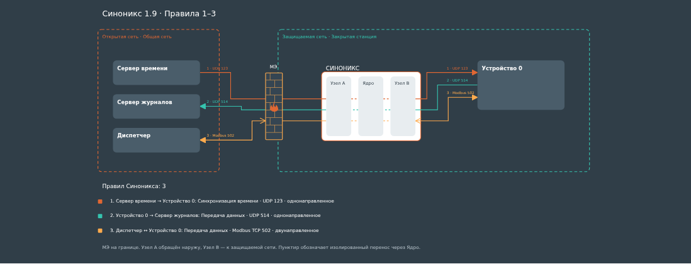
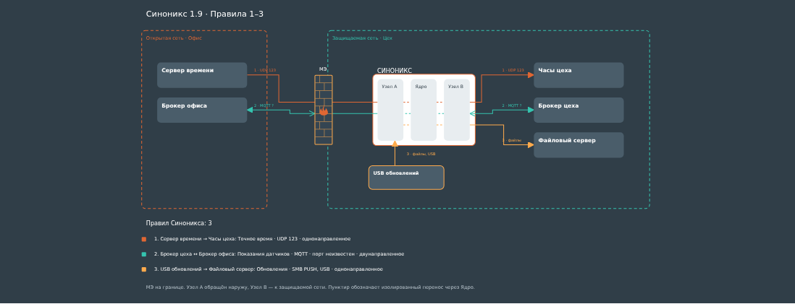

# Проверка схем — задача 06

Проверены синтетические нормализованные F02/F07 из `backend/tests/fixtures`,
расчёт трёх правил, схема в приложении и скачанный редактируемый XML. Проверка
не вызывает настоящую модель и не оценивает извлечение из свободного текста.

Исправлены найденные расхождения:

- Входящий USB получил наконечник на Узле А; двунаправленный — оба наконечника.
  USB соединяется прямо с А и не проходит через МЭ.
- Легенда называет отправителей, получателей, назначение, протокол/порт и режим;
  заголовок — «Правил Синоникса: N». Белый текст сопровождается цветной меткой.
- Подпись USB расположена рядом с линией над носителем. При нескольких USB-
  правилах подписи и вертикальные участки разнесены, под ними оставлено место.
- Кнопка проекта имеет постоянное доступное имя, в том числе когда мобильная
  оболочка скрывает видимый текст.

## Сверка с исходниками оформления

Прочитаны оригинальные локальные шаблон и два примера из комплекта. SHA-256:

| Файл | SHA-256 |
| --- | --- |
| `06_template.drawio` | `c8ebbc2a376f2046968327fa15269dfe9e72e373404b67aea76edddc51b87b20` |
| `05_pattern_F02.drawio` | `4ea88fa9714f3cffdcf8f0f9c8899ac46bc3fc6a35119bde1445a2112bd600e3` |
| `05_pattern_F07.drawio` | `81605e71479547d39b3981b99f1ec6b943c6fcc3946568f55a70e2f9de3fdf61` |

Проверены фон `#303E48`, рамки `#E06733/#35C4AF`, карточки `#4A5D6A`, Open Sans,
МЭ на границе, устройство внутри защищаемой сети, порядок А/Ядро/В и USB под А.
Координаты собственного вычисляемого графа не копируются из статичных примеров.
Расчёт и существующие сохранённые архивы не меняются.

## Воспроизведение

`test_diagram19_acceptance.py` проверяет F02/F07 и прямой/обратный/двусторонний
USB, идентичные координаты и точки маршрутов XML/сцены, ортогональность,
палитру, номера, легенду, разнесение сокетов общей карточки и подписей, а также
три раздельных USB-правила. Короткая регрессия до исправления воспроизводила
пропущенные USB-наконечники и неверный заголовок.

`scripts/ci/browser_diagram19_acceptance.py` запускается только на изолированном
loopback-подключении с `PARTNER_DIAGRAM_FIXTURE_CONFIRMED=1` и одноразовым
аккаунтом `PARTNER_DIAGRAM_BROWSER_ACCOUNT_FILE`. `CHROMIUM_PATH` необязателен,
`PARTNER_DIAGRAM_REPORT_DIR` задаёт приватный каталог снимков/экспортов.
Проверяются SVG, скачанный XML, увеличение/вписывание/перемещение, ширина 390,
повторное открытие проекта после мобильной перезагрузки, новая подпись после
правки и неизменные байты старой версии. Модельных вызовов — ноль.

Скачанные F02 и F07 затем отдельно открыты в настоящем локальном draw.io:

```sh
PYTHONPATH=backend/src CHROMIUM_PATH=/path/to/chromium \
  python scripts/ci/browser_drawio_roundtrip.py /path/to/drawio/webapp \
  --input /private/report/f07.drawio
```

Использован [исходник редактора f411a11](https://github.com/jgraph/drawio/tree/f411a11f4f6b8994d869bdbc45f4d4d9e2284f34/src/main/webapp).
Скрипт блокирует обращения вне локального origin. В каждом файле переименован
и перемещён «Сервер времени», результат сохранён и повторно открыт. Проверены
новая подпись, координаты, прежние концы связей, цвета/наконечники и строки правил.

Полный `./init.sh check`: **517 backend/18 frontend**, Ruff, mypy 93 модуля,
TypeScript/build. Шесть затронутых PostgreSQL-проверок ревизий, артефактов и
защищаемой стороны прошли; Alembic upgrade/check прошли. Браузерный сценарий
и два независимых round-trip во внешнем редакторе прошли. Cloud CI для прямого
push не объявляется зелёным. Произвольные большие графы и крайние длины имён
этим набором не проверены исчерпывающе; смысловой прогон модели — задача 12.

## Снимки

В снимках только синтетическая диаграмма без аккаунтов, переписки и ключей.
Полный вид компактен; для чтения деталей доступны масштаб и таблица.




