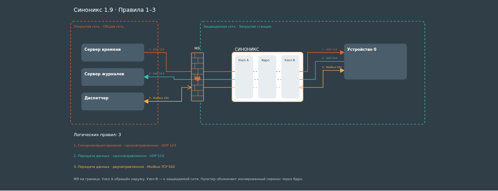

# Задача 01: размещение и сетевые правила

Проверка опирается на F01/F02 из [сценариев](ACCEPTANCE.md), правила данных
из [ТЗ](SPECIFICATION.md#правила-данных) и §§2, 3.1, 3.3 методологии 1.9.
В тестах — самостоятельно подготовленные синтетические условия, без частных
исходных материалов и без вызова модели. Это проверка программного расчёта
после разбора требований, а не оценка извлечения из свободного текста.

## Матрица

| Условия | Проверяемый итог |
| --- | --- |
| F01: три отправителя журналов, один получатель, UDP 514, без ответа | 1 правило, все три отправителя сохраняются |
| У третьего отправителя другой получатель | 2 правила |
| У третьего отправителя другой порт | 2 правила |
| У третьего отправителя TCP вместо UDP | 2 правила |
| Третьему отправителю нужен ответ вместо односторонней передачи | 2 правила |
| Перестановка сетей, систем и требований | Состав и стабильные ID правил не меняются |
| F02: Modbus TCP 502, журналы UDP 514 наружу, NTP UDP 123 внутрь | 3 правила, 0 файловых пользователей; Modbus двунаправленный |
| Запрос/ответ по одному соединению TCP, MQTT, Modbus TCP или МЭК 104 | 1 двунаправленное правило с обеими стрелками на конечных связях |
| Неизвестный порт Modbus, три получателя времени | Порт остаётся null; итог по-прежнему 3, одно NTP-правило |

Существующие проверки отдельно сохраняют различие неизвестной совместимости
и подтверждённого минимума, корректность промышленного режима, явный выбор
защищаемой стороны в расчётной функции и превышение ёмкости без обрезки правил.

## Найденная и исправленная ошибка

До правки новый F02-тест давал `1 failed, 6 passed`: расчёт выдавал правильные
три правила, но ориентированный граф не пропускал запрос от диспетчера к
контроллеру. Общий renderer 1.9 ставил только стрелки к конечным системам,
изображая ответ без направления запроса у инициатора.

На конечных участках двунаправленного правила теперь есть обе стрелки.
Обычный однонаправленный поток и пунктир изолированного переноса не меняются.
Раскладка, число правил и алгоритм минимизации не переписаны. SVG и native XML
используют те же флаги сохранённой сцены. Правка общего участка также применима
к двусторонним файловым связям; отдельная USB-ветвь и файловая минимизация
не менялись и относятся к задачам 02/06.

В тесте МЭ пересекает границу защищаемой области, корпус находится внутри,
Узел А обращён наружу, Узел В — внутрь. Путь запроса и ответа Modbus проверен
по фактическим стрелкам. Удаление любого из МЭ/Узла А/Ядра/Узла В разрывает
путь: обхода нет. Журналы и NTP проходят в нужную сторону, обратный путь
для них не разрешён. Нативный draw.io содержит те же конечные стрелки.

PostgreSQL-сценарий сохраняет F02 через проектный API и сравнивает повтор,
сцену и XML. Повтор команды возвращает прежнюю ревизию и точные байты.
Старые архивы не перерисовываются: исправленные стрелки появляются в новой
ревизии, созданной после обновления кода.

## Границы

- Полный визуальный шаблон F07, USB, редактор modify/save/reopen и читаемость
  сложных файловых связей остаются задачей 06, а минимизация файлов — задачей 02.
- Взаимодействие с двумя открытыми сетями и сохранение согласованного выбора
  защищаемой стороны в пользовательском проекте относятся к задаче 03.
  Успех прямого вызова функции с protected_network_id не закрывает этот путь.
- Реальное модельное извлечение, содержательные ответы и конкурсный прогон
  не заменяются этими проверками. Среднее время модели и расходы не измерялись.

Общий `./init.sh check`: 500 backend/18 frontend, Ruff, mypy 93 модуля,
TypeScript/build прошли. Настоящая PostgreSQL: 197 passed, 543 deselected,
четыре прежних Hatchet deprecations без выбранных skips, Alembic прошёл.
Chromium проверил F02/обе стрелки SVG/native XML/zero calls/390 px; снимок
выше просмотрен визуально. Основной стек не обновлялся, свои QA-контейнеры
остановлены. Платных запросов не выполнялось.
