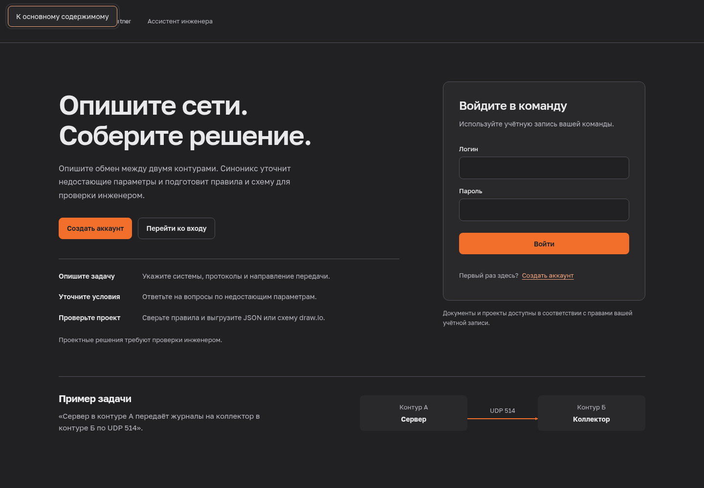
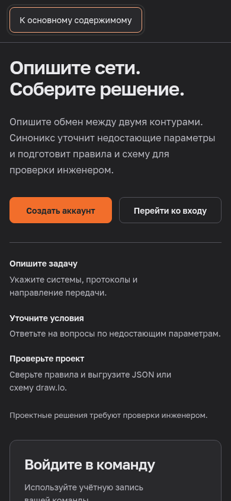
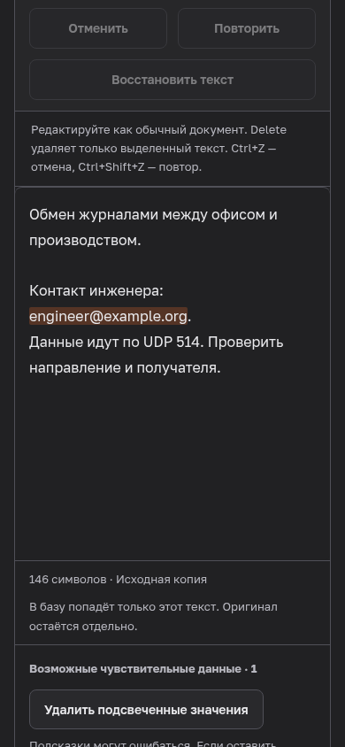
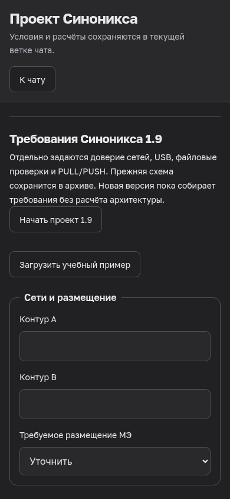

# Аудит интерфейса — 21 ноября 2026

## Область и порядок

Система проектирования Синоникса; инженер, модератор и администратор. Основное действие — подготовить и проверить проект. React 19/Vite сохраняются. Только JSX/CSS и визуальная композиция; исключение, прямо порученное владельцем, — фиксация тёмной темы и удаление её выбора. API, state чата, права, расчёт и маршрутизация неизменны.

## Страницы и маршруты

| Маршрут/состояние | Экран | Файл |
| --- | --- | --- |
| `/`, гость | Лендинг, вход, регистрация, загрузка сессии, ошибка подключения | `main.tsx`, `entry/EntryPage.tsx` |
| `/`, пользователь | Первый чат, новый разговор, история, ответ, уточнение, вложения | `workspace/Workspace.tsx` |
| `/knowledge`, менеджер | База знаний, версии, редактор, публикация, права, поиск, веб-источники | `knowledge/Knowledge.tsx` |
| Поверх рабочего пространства | Проект: требования, версия, расчёт, схема и экспорт | `workspace/ProjectPanel.tsx` |
| Поверх базы/чата | Команды, группы, участники | `admin/Groups.tsx` |
| Поверх чата | Переименование, удаление, редактирование в новой ветке | `workspace/Workspace.tsx` |
| Поверх приложения (до изменения) | Выбор четырёх тем; удаляется по поручению владельца | `main.tsx` |

Отдельного клиентского роутера нет: `/knowledge` определяется существующим pathname/history. Вход и регистрация — состояния одной страницы, собственных URL нет. Вкладки/панели сохраняют существующий способ открытия.

## Полная инвентаризация компонентов

| Файл относительно src | React-компоненты |
| --- | --- | --- |
| `admin/Groups.tsx` | `Groups` |
| `entry/EntryPage.tsx` | `EntryPage` |
| `knowledge/Access.tsx` | `Access` |
| `knowledge/Audience.tsx` | `Audience` |
| `knowledge/CorpusSummary.tsx` | `CorpusSummary` |
| `knowledge/DocumentEditor.tsx` | `Highlight`, `DocumentEditor` |
| `knowledge/GroupAccess.tsx` | `GroupAccess` |
| `knowledge/GroupDenies.tsx` | `GroupDenies` |
| `knowledge/GroupMembers.tsx` | `GroupMembers` |
| `knowledge/Knowledge.tsx` | `SourceSnapshot`, `Knowledge` |
| `knowledge/SearchPreview.tsx` | `SearchPreview` |
| `knowledge/WebSearch.tsx` | `WebSearch` |
| `main.tsx` | `ErrorNotice`, `EntryAuth`, `Appearance`, `App` |
| `ui.tsx` | `Icon`, `Brand` |
| `workspace/AccountingPanel.tsx` | `AccountingPanel` |
| `workspace/AnswerSources.tsx` | `SourceFragment`, `Citation`, `AnswerSources` |
| `workspace/CalculatedProject.tsx` | `CalculatedProject` |
| `workspace/ChatAttachments.tsx` | `ChatAttachments` |
| `workspace/DesignPanel.tsx` | `DesignPanel` |
| `workspace/DesignResultCard.tsx` | `DesignResultCard` |
| `workspace/DiagramViewer.tsx` | `DiagramViewer` |
| `workspace/ProjectClarifications.tsx` | `ProjectClarifications` |
| `workspace/ProjectPanel.tsx` | `ProjectPanel` |
| `workspace/RequirementsPanel.tsx` | `Bool`, `RequirementsPanel` |
| `workspace/VendorWishesExport.tsx` | `VendorWishesExport` |
| `workspace/Workspace.tsx` | `DesignExample`, `WorkspaceError`, `RunState`, `Workspace` |

## Стили и остальные UI-модули

- `admin/groups.css`
- `auth.css`
- `brand.css`
- `entry/entry.css`
- `knowledge/knowledge.css`
- `style.css`
- `themes.css`
- `workspace/design.css`
- `workspace/diagram.css`
- `workspace/project-questions.css`
- `workspace/workspace.css`

Презентационные ресурсы: `product.ts`, `ui.tsx`, `scene.ts`, `glass.ts`, `vendor/liquid-glass-core.js`, `public/brand/it-bastion-white.svg`. Хуки `useWorkspace`, `useTurnTiming`, `useAnswerPlayback`, модули api и обработка файлов не перерабатываются.

## Найдено до правок

- `entry/entry.css`: градиентная панель, три равные колонки процесса, подложка и padding у уже прозрачного SVG.
- `style.css`, `themes.css`, рабочие стили: несколько конкурирующих систем цветов и скруглений, текст 9–11 px в рабочих формах, контрастные светлые hover-поверхности в тёмной теме.
- `knowledge/knowledge.css`: три боковые декоративные полосы; активный чат в `style.css` — ещё одна. Это четыре находки source detect.
- Авторизация: выбор темы отделён от инженерной задачи, сохраняется светлая/стеклянная тема. По дополнению владельца остаётся только dark.
- Редактор/таблицы/права: тесные подписи и кнопки, недостаточно общего вертикального ритма.

## Проверки

До изменений выполнен `npx impeccable detect outputs/partner-prototype/src`: 57 файлов, 4 находки (regex only). Это не проверка контраста/геометрии в браузере. После каждого этапа — тот же детектор, затем сборка и реальные снимки на широком и узком экранах. Никакого модельного прогона.

## Источники и приоритет

Требования владельца → `docs/DIAGRAMS.md`/методичка → `DESIGN.md` → установленные скиллы. Vercel: фокус, семантика, адаптивность. Impeccable: ритм, отсутствие декоративных полос/градиентов, читаемость. Taste: равные края, предметный текст, общий визуальный язык. Случайные палитры, рекламные эффекты и замена React из общих рецептов не применяются: бренд и функциональные ограничения уже заданы. Composition: сохраняем существующие компоненты и их контракт, без переделки state/props.

## Установка и применение скиллов

Установка выполнена в отдельном `sinoniks-design-tools` (Node 22), поскольку
в терминале Windows отсутствует npx. Файлы проверены в `.agents/skills/`:
`web-design-guidelines`, `vercel-composition-patterns`, `impeccable` (4.10.0),
`design-taste-frontend` (2.5.1). Их SKILL.md и профильные правила прочитаны.

Запрошенная первая команда установила web-design-guidelines, но точное имя
composition-patterns отсутствует в upstream. Дополнительная установка
`--skill vercel-composition-patterns` завершилась успешно. Impeccable установлен
командой `npx --yes impeccable install --providers=codex --scope=project`,
Taste — запрошенным skills add. Везде автоподтверждение, без интерактива.
Локальные наборы/бинарники не включаются в исходники продукта; зависимости
приложения и конфигурация сборки не менялись.

## Проверки по экрану

| Экран | Что изменено | Что проверено |
| --- | --- | --- |
| Лендинг | Прозрачный логотип, плоский фон, крупная типографика, вертикальный процесс, единые края | 1440/1024/768/390/320, переход к форме, принудительный dark |
| Вход и регистрация | Поля 44 px, читаемый контраст, primary-кнопка, inline-ошибки | Настоящие вход/регистрация в отдельной БД, неверный пароль, повтор подключения |
| Чат и первый разговор | Убрана декоративная иконка, читаемые метаданные/ответы, спокойный active, поле ввода | Создание, синтетический ответ, мобильный экран, переименование, сохранённая история |
| Проект и уточнения | Общая сетка/поля/fieldset, понятные разделы и ошибки | Пустой редактор требований, сохранённый проект, таблица и схема; U03 семь шагов, 1→2→2→1, экспорт и reload |
| Схема | Только toolbar, масштаб и таблица вокруг SVG | Широкий/мобильный просмотр; генератор и цвета сцены/draw.io не менялись |
| Расходы и источники | Размеры текста/кнопок, числовая типографика, разделители вместо лишних карточек | Раскрытие расходов, сохранены прежние сообщения/контракты фрагментов; никаких новых платных вызовов |
| База знаний | Отступы, размеры текста, документные строки, единые кнопки | Выбор документа/версии, текущие статусы, ширины 1440/390/320 |
| Модерация | Единые метрики textarea и подсветки, читаемый dark-текст, общий мобильный scroll | Синтетическая каноническая копия: выделение части слова/Delete/Ctrl+Z, совпадение font/padding, подсветка контакта |
| Поиск, веб-поиск и сводка | Формы/состояния и отступы общей системы | Отображение существующих пустых/недоступных состояний; внешние поисковые запросы не запускались |
| Права и группы | Читаемые подписи, строки участников/ID и поля, адаптивные действия | Открытие прав, обзор групп, создание пространства и группы в отдельной БД |

Все прикладные проверки выполняются в отдельных QA-контейнерах/БД с
синтетическими материалами и локальным HTTP-провайдером. Они не доказывают
качество модели. Общая приёмка12 отложена владельцем. Демонстрационный
localhost:8080, его dist, образ и настройки не обновлялись.

## Ограничения инструментов

`npx impeccable detect` исходников — regex-проверка; отсутствие находок не
означает полного WCAG-аудита. Для реальных экранов детектор дополнительно
подключён через CDP к Chromium, запущенному Playwright в отдельном контейнере.
Прямой URL-запуск детектора не смог запустить Chromium от root без no-sandbox;
CDP использует уже контролируемый тестовый браузер.

Дополнительный Taste finish gate: **GATE: ERROR**. Его собственный Chrome
не запустился в контейнере, а copy-lint получил React-shell без содержимого.
Его consistency/layout/perf не объявляются пройденными и повторно не запускались
по инструкции gate. Вместо них выполнены описанные проверки реального React
в Chromium, визуальный просмотр снимков и Impeccable/CDP. Рекламные рецепты
Taste (случайная палитра, фотографии/сцены, смена компонентов) не применены,
поскольку противоречат заданному бренду, методичке и запрету менять логику.

## Итоговая проверка и снимки

- Эквивалент `./init.sh check` выполнен раздельно в двух QA-контейнерах:
  lock check, Ruff, mypy (95 модулей), **561 backend / 18 frontend**, TypeScript/Vite.
  PostgreSQL этих проверок — собственная тестовая; рабочая БД не менялась.
- Сверка TypeScript AST: **110 бизнес-обработчиков JSX совпадают** с исходной
  версией. Исключён только удалённый выбор оформления. Код API, хуки, сервер,
  расчёт, генератор схемы, package.json и конфиги сборки не менялись.
- Source detect: 57 файлов, **0 находок**. Rendered/CDP: вход, регистрация,
  пустой чат, редактор требований, ошибки, права, поиск, веб-поиск, сводка и
  редактор документа проверены в живом React. Найденные проблемы контраста
  и вложенной ошибки исправлены. В исходном адаптивном списке групп снято
  сжатие строк с длинными ID. Детектор — дополнительный инструмент, не
  сертификат WCAG и не замена проверке человеком.
- Chromium: 320/390/1440 px; лендинг также 768/1024. Ошибок JavaScript и
  горизонтального переполнения страницы в пройденных сценариях нет.
- U03 на синтетическом HTTP: семь шагов, 1→2→2→1, версии/экспорты/reload.
  Живой модельный сценарий и финансовая приёмка не запускались.

Снимки содержат только синтетические тестовые данные:

| Лендинг, широкий экран | Лендинг, мобильный |
| --- | --- |
|  |  |

| Модерация, мобильный | Проект, мобильный |
| --- | --- |
|  |  |

Демонстрационный checkpoint на localhost:8080 сохранён без обновления.
Эти изменения требуют отдельного развёртывания, чтобы появиться в демонстрации.

В мобильном управлении группами остаётся advisory `flat-type-hierarchy`
(код возврата детектора0): его сводка включает h3 16 px из фоновой сводки
под модальным окном. Проверены computed styles действующего окна:
заголовок и название пространства24 px, секции18 px, основной текст14 px;
фон имеет `inert`. Предупреждение не скрывалось настройками/игнорами;
не меняли существующую логику модального окна ради метрики.
